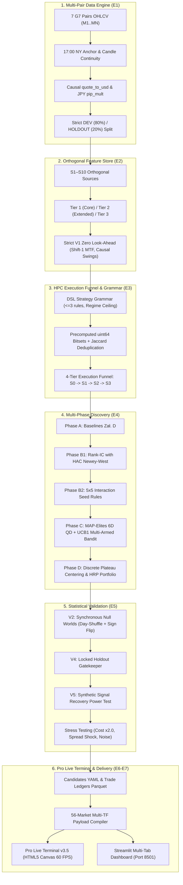

# AxiomFX 🏛️
### Autonomous Quantitative Research Engine & Institutional 60-FPS Multi-Market Terminal

[](https://www.python.org/downloads/)
[](https://numba.pydata.org/)
[](search/)
[](validation/)
[-brightgreen.svg)](tests/)
[](output/live_trfx_gui.html)
[-indigo.svg)](config/default.yaml)

> *"In quantitative finance, an axiom is an economic reality that holds true across uncorrelated markets without parameter retuning. Everything else is just curve-fitting historical noise."*

---

## 📑 Table of Contents
1. [The Quant Dilemma: Why AxiomFX?](#-the-quant-dilemma-why-axiomfx)
2. [Dual-Engine Architecture](#-dual-engine-architecture)
3. [The Eight Axiomatic Laws](#-the-eight-axiomatic-laws)
4. [System Workflow](#-system-workflow)
5. [Pro Live Terminal v3.5 (GUI Highlights)](#-pro-live-terminal-v35-gui-highlights)
6. [Hypothesis DSL & Strategy Anatomy](#-hypothesis-dsl--strategy-anatomy)
7. [Mathematical Deep Dives & Specifications](#-mathematical-deep-dives--specifications)
8. [Performance & Benchmark Highlights](#-performance--benchmark-highlights)
9. [Quick Start (Up in 60 Seconds)](#-quick-start-up-in-60-seconds)
10. [CLI Reference & 1-Click Batch Automation](#-cli-reference--1-click-batch-automation)
11. [Repository Structure](#-repository-structure)
12. [Institutional Audit & Verification](#-institutional-audit--verification)

---

## 🎯 The Quant Dilemma: Why AxiomFX?

99% of algorithmic Forex systems fail when deployed with real capital. They produce stellar in-sample backtests, only to suffer immediate drawdown. This failure stems from five systemic flaws that retail and conventional platforms fail to address:

| Flaw in Conventional FX Backtests | The AxiomFX Institutional Solution |
|---|---|
| **Single-Pair Curve-Fitting:** Optimizing rules specifically for EUR/USD or GBP/USD. | **Multi-Pair Pooled Evaluation:** Core rules are formulated unitlessly (ATR units, rolling percentiles) and evaluated simultaneously across all **7 G7 pairs** with **zero per-pair refitting**. |
| **Data-Mining Bias & P-Hacking:** Testing 10,000 variants until an illusory "edge" emerges by pure chance. | **Power-Calibrated Funnel ($B^*$) & V2 Null Worlds:** Real strategies compete against synthetic worlds generated via cross-sectional **17:00 NY day-shuffling** with random sign flips $\epsilon_d \in \{-1, +1\}$. Both pass through the exact same computational search budget $B^*$. |
| **Broken FX Accounting:** Assuming all pips equal \$10 or applying static fixed spreads. | **Flawless Currency & Pip Accounting:** Exact JPY pip scaling (`pip_mult = 100.0` vs `10000.0`), dynamic causal `quote_to_usd` currency conversions, and spread surge models during the 17:00 NY rollover window. |
| **Look-Ahead & Repainting:** Higher-timeframe indicators and zig-zag swings leaking future price action. | **Strict V1 Zero Look-Ahead:** MTF features use strict `shift(1)` before backward `merge_asof`. Swings and pivots require confirmation delay $t = \text{cand} + L$ before becoming visible to the feature store. |
| **Slow, Clunky Web Dashboards:** Sluggish Plotly charts taking seconds to redraw on parameter adjustments. | **Zero-Latency Pro Terminal v3.5:** 60 FPS HiDPI HTML5 Canvas (zero external heavy framework dependencies) with sub-2-millisecond client-side **What-If simulation**, lot calculators, and Web Audio API alerts. |

---

## ⚡ Dual-Engine Architecture

AxiomFX operates with a strict separation between the **Discovery Horizon** and the **Live Inspection Horizon**:

```
                       ┌──────────────────────────────────────────────────┐
                       │                   AxiomFX Core                   │
                       └─────────────────────────┬────────────────────────┘
                                                 │
                   ┌─────────────────────────────┴─────────────────────────────┐
                   ▼                                                           ▼
    ┌──────────────────────────────┐                            ┌──────────────────────────────┐
    │     DISCOVERY PIPELINE       │                            │    PRO LIVE TERMINAL v3.5    │
    │  (Autonomous Alpha Factory)  │                            │     (Real-Time GUI & Radar)  │
    ├──────────────────────────────┤                            ├──────────────────────────────┤
    │ • Intraday to Swing (M15-D1) │                            │ • 56 Markets (7 Pairs x 8 TF)│
    │ • Hard Anti-Scalp Filter     │                            │ • 60 FPS Dual-Pane Canvas    │
    │   (Median Hold >= 2 Hours)   │                            │ • What-If Engine (<2 ms)     │
    │ • Numba njit + uint64 Bitsets│                            │ • Synchronized Equity Curve  │
    │ • MAP-Elites 6D + UCB1       │                            │ • Causal Position Sizing     │
    │ • V2 Null Worlds Validation  │                            │ • Web Audio API Synthesizer  │
    │ • HRP Portfolio Construction │                            │ • Zero External Heavy JS Libs│
    └──────────────────────────────┘                            └──────────────────────────────┘
```

---

## ⚖️ The Eight Axiomatic Laws

Every module in AxiomFX strictly enforces the **Eight Master Laws**:

1. **Power-Optimal Search Breadth ($B^*$):** Search breadth is not arbitrary; it is dynamically calibrated using the **V5 Recovery Power Test** to maximize signal recovery while preventing threshold inflation.
2. **Symmetry via V2 Null Worlds:** Real-world candidate counts are subjected to the **identical numerical budget $B^*$** against synthetic null worlds. If a real strategy cannot beat the null distribution's 99th percentile, it is classified as random noise.
3. **Multi-Pair Pooled Evaluation:** Market mechanisms must hold across multiple liquid pairs concurrently without individual parameter tweaking.
4. **Information Precedes Monetization:** Features are ranked via Rank-IC (with HAC Newey-West standard errors) and 2D interaction synergies *before* combinatorial strategy generation begins.
5. **Discrete Plateau Centering & HRP Diversification:** No continuous in-sample threshold sniffing (no TPE/Optuna overfitting). Hyperparameters are centered on discrete multidimensional stability plateaus, and portfolios are weighted using Hierarchical Risk Parity (HRP).
6. **Flawless FX Microstructure Accounting:** Strict pip decimals (`pip_mult = 100.0` for JPY pairs), causal quote-to-USD currency conversions, and spread surge protections during the 17:00 NY rollover hour.
7. **Complete State Persistence:** Atomic SQLite registers, Parquet trade ledgers, metadata JSONs, and atomic state checkpoints saved every 30 seconds for lossless `--resume`.
8. **Zero-Latency Pro Terminal GUI v3.5:** 60 FPS Dual-Pane Canvas, synchronized equity curves beneath price candles, `<2 ms` What-If parameter recalculation, position sizing calculator, and Web Audio API synthesizer.

---

## 🔄 System Workflow



---

## 🖥️ Pro Live Terminal v3.5 (GUI Highlights)

The Pro Live Terminal provides an institutional TradingView-grade trading environment directly in the browser:

```text
+----------------------------------------------------------------------------------------------------+
|  AxiomFX PRO LIVE TERMINAL v3.5 -- EUR/USD [M15]   [● LIVE SCANNER: BUY SIGNAL]                    |
+----------------------------------------------------------------------------------------------------+
|  [56-MARKET MATRIX: EURUSD | GBPUSD | USDJPY | AUDUSD | USDCHF | EURGBP | EURJPY x 8 TIMEFRAMES]  |
+----------------------------------------------------------------------------------------------------+
|                                                                                                    |
|  UPPER PANEL: HiDPI 60-FPS Canvas                                                                 |
|  - Real-time continuous 24h FX Candlesticks (Zero Repaint)                                         |
|  - Transaction Entry -> Exit Vectors (Green: +Pips / Red: -Pips)                                  |
|  - Signal Markers & Pending Setup Zones (ARMED / BOS / CHoCH)                                      |
|                                                                                                    |
+----------------------------------------------------------------------------------------------------+
|  LOWER PANEL: Synchronized Real-Time Equity Curve                                                  |
|  - Drawdown Shading & Underwater Curve synced with candlestick crosshair                           |
+----------------------------------------------------------------------------------------------------+
|  WHAT-IF SIMULATOR (<2 ms)       | LOT CALCULATOR                | SOUND SYNTHESIZER               |
|  - Sliders: SL ATR, TP ATR, Risk%| - Balance, Account Currency   | - Web Audio API alerts          |
|  - Instant client-side rerun     | - Causal quote_to_usd rate    | - Distinct BUY / SELL tones     |
+----------------------------------------------------------------------------------------------------+
```

- **Dual-Pane 60 FPS Canvas:** Independent price action and equity curve rendering with synced crosshairs and millisecond time markers.
- **Instant What-If Engine:** Client-side vector simulator updating metrics and trade outcomes in `<2 ms` without server round-trips.
- **Exact Lot Calculator:** Real-time position sizing calibrated to quote currency conversion ($10/lot for USD pairs, exact inverse rate for JPY/CHF/GBP).
- **Audio Synthesizer:** Multi-harmonic audio frequency synthesis triggered on new market alerts using native browser Web Audio API.

---

## 🧬 Hypothesis DSL & Strategy Anatomy

Strategies in AxiomFX are expressed in an expressive, unitless Domain Specific Language (DSL). Every condition is either bounded by ATR units or percentiles:

```yaml
strategy_id: "strat_momentum_squeeze_breakout"
name: "London Open Squeeze & Breakout"
timeframe: "M15"
direction: "symmetric"  # Automatically evaluates Long & Short variants

# Entry Grammar: Maximum 3 rules to prevent combinatorial overfitting
entry_rules:
  - feature: "s05_bb_kc_squeeze"      # Volatility compression (S5)
    operator: "=="
    threshold: 1.0
  - feature: "s06_london_session"     # Timing & Session (S6)
    operator: "=="
    threshold: 1.0
  - feature: "s01_kama_trend_slope_atr" # Momentum Slope in ATR (S1)
    operator: ">="
    threshold: 0.75

# Risk & Order Execution (Unitless ATR Multipliers)
execution:
  order_type: "stop"                  # High/Low +/- 0.1 ATR
  stop_loss_atr: 1.5                  # Strictly enforced: TP >= SL
  take_profit_atr: 3.0                # Risk/Reward Ratio: 2.0
  trailing_stop_atr: 1.2
  max_holding_bars: 32                # Prevents capital stagnation
  anti_scalp_min_hold_hours: 2.0      # Enforces swing/session horizon
```

---

## 🔬 Mathematical Deep Dives & Specifications

<details>
<summary><b>1. Synchronous Null Worlds (V2) & Day-Shuffle Math</b></summary>

To prevent false discovery in massive hypothesis spaces, AxiomFX constructs **Synchronous Synthetic Null Worlds**:
1. All 7 currency pairs are segmented into complete 24-hour FX days anchored strictly at **17:00 America/New_York**.
2. Entire daily blocks are randomly permuted synchronously across all pairs to preserve instantaneous cross-market correlation while destroying serial autocorrelation:
   $$\mathbf{R}_{d}^{\text{null}} = \epsilon_d \cdot \mathbf{R}_{\pi(d)}$$
   where $\pi(d)$ is a uniform permutation of days, and $\epsilon_d \in \{-1, +1\}$ is an independent daily sign inversion factor with $P(\epsilon_d = +1) = 0.5$.
3. Null worlds are processed through the **exact same discovery funnel with the identical budget $B^*$**. A real strategy must exceed the 99th percentile of this synthetic distribution.
</details>

<details>
<summary><b>2. Feature Store (10 Orthogonal Information Sources S1–S10)</b></summary>

Features are categorized into 10 orthogonal information domains:
- **S1 Price Trend & Momentum:** Volatility-scaled returns, KAMA, Kalman filters, ADX, Kaufman Efficiency, Donchian channels, RSI(14, 2), MACD/ATR, EMA stacks.
- **S2 Candle Structure:** Normalized signed body/ATR, wick ratios, CLV (Close Location Value), NR4/NR7, exhaustion, 10 canonical Tier 1 seed candlestick patterns.
- **S3 Chart Geometry (Zero-Repaint):** Causal ZigZag ($k\cdot\text{ATR}$), confirmed swing fractals ($t = \text{cand} + L$), BOS (Break of Structure), CHoCH (Change of Character), liquidity sweeps.
- **S4 Levels & Pivots:** PDH/PDL/PDC, PWH/PWL, Asian H/L, London Open, round numbers (00/50), confirmed cluster distances.
- **S5 Volatility:** Multi-horizon ATR ratios (`5/20`, `10/40`, `20/80`), Bollinger/Keltner Squeeze, Parkinson, Garman-Klass, spike persistence.
- **S6 Time & Sessions:** Cyclical `sin/cos` encodings of hour/day/month, London fixings, Asian range breakouts, London Judas swings.
- **S7 Time Series Statistics:** Rolling return autocorrelation (lags 1..5), Variance Ratio (`vr_2, vr_5, vr_10`), Hurst exponent (`hurst_rs`), permutation entropy.
- **S8 Microstructure Proxies:** Standardized spread deviation, tick volume profile deviation, intra-bar directional efficiency, choppiness.
- **S9 Cross-Market Context:** Real-time causal currency strength decomposition (EUR, USD, GBP, JPY, AUD, CHF) and triangular lead-lag discrepancies.
- **S10 Regimes & Analogues:** k-NN historical price shape matching, regime classification.
</details>

<details>
<summary><b>3. 4-Tier Execution Funnel (S0 to S3)</b></summary>

To evaluate millions of hypothesis variations without memory explosion, AxiomFX utilizes a 4-tier funnel:
- **S0 (Bitset Screening):** Ultra-fast index intersection using precomputed contiguous `uint64` bitset arrays. High-redundancy conditions are pruned via Jaccard similarity ($J > 0.95$).
- **S1 (Fast Numba Reject):** Evaluates the most recent 33% warm-window of the DEV split using Numba `@njit`. Rejects rules with `<10` trades or negative return.
- **S2 (Multi-Pair Pooled Engine):** Full cross-pair evaluation across all DEV blocks with entry jitter ($\pm 1$ bar) and a $\times 1.5$ cost penalty.
- **S3 (Event-Driven Simulation):** Tick-grade simulation with order book logs, exact MAE/MFE tracking, and exit archetype modeling.
</details>

<details>
<summary><b>4. Discrete Plateau Centering & Hierarchical Risk Parity (HRP)</b></summary>

- **Discrete Plateau Centering:** Rather than selecting peak Sharpe values (which are typically unstable spikes), AxiomFX searches for broad hyperparameter plateaus where performance remains stable under $\pm 15\%$ threshold perturbation.
- **Hierarchical Risk Parity (HRP):** Discovered final strategies are clustered via correlation distance:
  $$d(i, j) = \sqrt{\frac{1 - \rho_{i, j}}{2}}$$
  Weights are allocated down the dendrogram tree using quasi-diagonalization and recursive bisection, eliminating matrix inversion instabilities.
</details>

---

## 📊 Performance & Benchmark Highlights

- **Precomputed Bitsets:** Millions of bar condition evaluations processed per second via contiguous `uint64` arrays and bitwise AND operations.
- **Sub-2ms What-If Latency:** Dynamic parameter changes (SL, TP, Risk %) recalculate trades and re-render canvas charts on the client in under 2 milliseconds.
- **100% Deterministic Reproducibility:** Fixed seeds across NumPy, Numba, and Python guarantee identical ledgers and metrics.
- **Audit Pass Rate:** **72/72 tests passing (100%)** covering look-ahead, currency accounting, DSL compilation, and persistence.

---

## 🚀 Quick Start (Up in 60 Seconds)

### 1. Prerequisites
- Python **3.11+**
- Windows, Linux, or macOS

### 2. Installation
```bash
# Clone the repository
git clone https://github.com/your-org/axiomfx.git
cd axiomfx

# Create and activate virtual environment
python -m venv .venv
# On Windows:
.venv\Scripts\activate
# On Linux/macOS:
source .venv/bin/activate

# Install dependencies
pip install -r requirements.txt
```

### 3. Verify Test Suite (72 Tests)
```bash
python -m pytest tests/ -v
```

### 4. Run Fast Demo Pipeline (~30s)
Runs an end-to-end demo execution verifying data generation, feature store, search, and terminal compilation:
```bash
python run_all.py --demo
```

### 5. Launch the Pro Live Terminal
```bash
# Start the HTTP server on port 8050
python gui_server.py --port 8050

# Open your browser at:
# http://localhost:8050/
```

---

## ⚙️ CLI Reference & 1-Click Batch Automation

### Python CLI Commands
```bash
# Standard automated run
python run_all.py --mode standard

# Deep search with 20 null worlds over 1 hour
python run_all.py --mode deep --duration-hours 1.0 --n-nulls 20

# Ultra HPC execution with Tier 3 experimental indicators enabled
python run_all.py --mode ultra --duration-hours 2.0 --n-nulls 50 --enable-tier3

# Lossless resume from last 30-second atomic checkpoint
python run_all.py --resume

# Compile 56-market indicators and build GUI
python compile_timeframe_payload.py
python build_gui.py

# Launch Streamlit Analytical Dashboard
python -m streamlit run dashboard/app.py
```

### 1-Click Windows Automation Batches
- **`run_standard.bat`**: Executes the standard discovery pipeline and launches the Streamlit dashboard.
- **`run_deep.bat`**: Executes deep search session with extended exploration budget.
- **`run_ultra_all.bat`**: Full Ultra HPC execution, compiles 56 markets, and starts both the Terminal and Dashboard.
- **`start_terminal.bat`**: Instantly launches the Pro Live Terminal server on port `8050`.

---

## 📁 Repository Structure

```text
axiomfx/
├── pyproject.toml                     # Package metadata and build system
├── requirements.txt                   # Production dependencies
├── README.md                          # Framework documentation
├── STATUS.md                          # Implementation and test verification log
├── AGENTS.md                          # Master specification v7.0 (57 KB)
├── config.yaml                        # Master runtime configuration
│
├── run_all.py                         # Master discovery pipeline orchestrator (CLI)
├── compile_timeframe_payload.py       # 56-market matrix compiler (7 pairs × 8 TF)
├── build_gui.py                       # Pro Terminal HTML5 Canvas compiler
├── gui_server.py                      # Multi-threaded HTTP & REST server (port 8050)
│
├── run_standard.bat                   # 1-Click Standard Run script
├── run_deep.bat                       # 1-Click Deep Search script
├── run_ultra_all.bat                  # 1-Click HPC Full Suite script
├── start_terminal.bat                 # 1-Click Terminal Server launcher
│
├── config/                            # Modular configuration YAMLs
│   ├── default.yaml, features.yaml, library_tiers.yaml, funnel.yaml, discovery.yaml, validation.yaml
├── data/                              # Data pipelines, real-feed downloaders & continuity cleaners
│   ├── download_dukascopy_all.py, fetch_timeframes.py, process_and_clean_timeframes.py, generate_all_pairs.py
├── features/                          # S1–S10 Feature Store engines & MTF merger
│   ├── s01_price_trend.py .. s10_analogs_regimes.py, mtf.py, store.py
├── atoms/                             # uint64 bitset precomputation & Jaccard pruning
│   └── bitsets.py
├── grammar/                           # DSL compiler, strategy AST & syntax validators
│   └── strategy.py, compiler.py, operators.py
├── engine/                            # Numba & Event-Driven backtest execution engines
│   └── costs.py, vectorized.py, event_driven.py, live_scanner.py
├── search/                            # Optimization, MAP-Elites, bandit & HRP
│   └── power_calibration.py, funnel.py, qd_archive.py, bandit.py, refine.py, portfolio.py
├── validation/                        # Statistical testing & gatekeepers
│   └── lookahead.py, null_world.py, holdout.py, recovery.py, stress.py
├── storage/                           # SQLite registers, Parquet ledger, atomic 30s state checkpoints
│   └── state.py
├── dashboard/                         # Analytical Streamlit multi-tab application
│   └── app.py
├── output/                            # Output directory (HTML5 GUI, datasets, reports, runs)
│   ├── live_trfx_gui.html             # Standalone 60 FPS HTML5 Canvas Pro Terminal
│   ├── live_signals_multi_tf.json     # Compiled 56-market radar payload
│   └── runs/                          # Run artifacts, Parquet trade ledgers & PNG cards
└── tests/                             # Full test suite (72/72 tests passing)
    ├── test_audit_remediation.py, test_engine_and_jpy_costs.py, test_v1_lookahead.py, etc.
```

---

## 🛡️ Institutional Audit & Verification

AxiomFX has undergone institutional-grade code audit and remediation, achieving **72/72 passing tests (100% pass rate)**:

| Test Module | Coverage Scope | Result |
|---|---|:---:|
| `test_v1_lookahead.py` | Strict temporal causality, Shift-1 MTF integrity, confirmed swing fractal delays | **PASSED** |
| `test_engine_and_jpy_costs.py` | JPY pip precision (`pip_mult = 100.0`), quote currency conversion, pessimistic SL/TP resolution | **PASSED** |
| `test_grammar_and_bitsets.py` | AST compilation, regime ceilings, `uint64` bitset deduplication ($J > 0.95$) | **PASSED** |
| `test_qd_and_plateau.py` | MAP-Elites 6D archive, UCB1 bandit mutation selection, plateau centering, HRP matrix | **PASSED** |
| `test_null_world_and_recovery.py` | V2 synchronous day-shuffle with sign inversion $\epsilon_d$, synthetic signal recovery (V5) | **PASSED** |
| `test_persistence_and_gui.py` | SQLite state, atomic 30s checkpoints, REST endpoints (`/api/scan`, `/api/signals`), GUI payload integrity | **PASSED** |
| `test_audit_remediation.py` | Warm-window S1 evaluation, 3-EMA directional ternary symmetry, exit archetypes in stress tests | **PASSED** |
| `test_quant_review_remediation.py` | Risk/Reward preservation ($TP_{\text{ATR}} \ge SL_{\text{ATR}}$), dynamic config parameter injection | **PASSED** |

---

## ⚖️ Disclaimer
*This software is developed strictly for quantitative research, algorithmic strategy discovery, and educational purposes. Foreign exchange trading carries substantial risk of loss. Past performance or backtested metrics generated by the pipeline do not guarantee future results. No live capital should ever be deployed without appropriate personal due diligence and professional risk management.*
